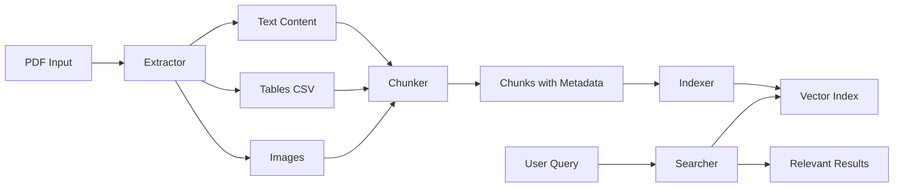

# Design Document

## Overview

The PDF RAG Pipeline is a modular system that processes PDF documents through four distinct stages: extraction, chunking, indexing, and searching. The design emphasizes simplicity, no external database dependencies, and efficient in-memory/file-based operations.

## Architecture

### High-Level Architecture



### Component Architecture

The system follows a pipeline architecture with four independent but interconnected stages:

1. **Extractor Stage**: Three specialized extractors handle different content types
2. **Chunker Stage**: Processes extracted content into semantic chunks
3. **Indexer Stage**: Generates embeddings and builds searchable index
4. **Searcher Stage**: Performs semantic search on indexed content

## Components and Interfaces

### 1. Extractor Components

#### extractor_text.py

**Purpose**: Extract textual content from PDFs

**Library Recommendation**: `pymupdf` (PyMuPDF)
- Fastest PDF text extraction
- Excellent handling of complex layouts
- Preserves formatting and structure
- Better than pdfplumber for pure text extraction

**Interface**:
```python
class TextExtractor:
    def extract(self, pdf_path: str) -> List[Dict[str, Any]]:
        """
        Extract text from PDF
        Returns: List of dicts with {page: int, text: str}
        """
        pass
```

#### extractor_tables.py

**Purpose**: Extract tables and save as CSV

**Library Recommendation**: `camelot-py` or `tabula-py`
- camelot-py: Better for complex tables, more accurate
- tabula-py: Faster, good for simple tables
- Recommendation: Use `camelot-py` for accuracy

**Interface**:
```python
class TableExtractor:
    def extract(self, pdf_path: str, output_dir: str) -> List[Dict[str, Any]]:
        """
        Extract tables and save as CSV
        Returns: List of dicts with {page: int, table_id: int, csv_path: str}
        """
        pass
```

#### extractor_images.py

**Purpose**: Extract images from PDFs

**Library Recommendation**: `pymupdf` (PyMuPDF)
- Excellent image extraction capabilities
- Preserves image quality
- Provides image metadata

**Interface**:
```python
class ImageExtractor:
    def extract(self, pdf_path: str, output_dir: str) -> List[Dict[str, Any]]:
        """
        Extract images from PDF
        Returns: List of dicts with {page: int, image_id: int, image_path: str}
        """
        pass
```

### 2. Chunker Component

**Purpose**: Split extracted content into semantic chunks

**Library Recommendation**: `langchain` text splitters
- RecursiveCharacterTextSplitter for text
- Built-in overlap handling
- Configurable chunk sizes

**Interface**:
```python
class Chunker:
    def __init__(self, chunk_size: int = 1000, chunk_overlap: int = 200):
        pass
    
    def chunk_text(self, text_data: List[Dict]) -> List[Dict[str, Any]]:
        """
        Chunk text content
        Returns: List of chunks with metadata
        """
        pass
    
    def chunk_tables(self, table_data: List[Dict]) -> List[Dict[str, Any]]:
        """
        Process tables as single chunks
        Returns: List of table chunks with metadata
        """
        pass
    
    def chunk_images(self, image_data: List[Dict]) -> List[Dict[str, Any]]:
        """
        Create chunks for images with metadata
        Returns: List of image chunks with metadata
        """
        pass
```

### 3. Indexer Component

**Purpose**: Generate embeddings and build searchable index

**Library Recommendation**: 
- Embeddings: `sentence-transformers` (all-MiniLM-L6-v2 model)
  - Fast and efficient
  - Good quality embeddings
  - No API calls needed
- Storage: `numpy` + `pickle` for file-based storage
  - Simple and effective
  - No database required
  - Fast in-memory operations

**Interface**:
```python
class Indexer:
    def __init__(self, model_name: str = "all-MiniLM-L6-v2"):
        pass
    
    def index_chunks(self, chunks: List[Dict]) -> None:
        """
        Generate embeddings and build index
        """
        pass
    
    def save_index(self, index_path: str) -> None:
        """
        Save index to disk
        """
        pass
    
    def load_index(self, index_path: str) -> None:
        """
        Load index from disk
        """
        pass
```

### 4. Searcher Component

**Purpose**: Perform semantic search on indexed content

**Library Recommendation**: 
- `numpy` for cosine similarity computation
- `sentence-transformers` for query embedding

**Interface**:
```python
class Searcher:
    def __init__(self, indexer: Indexer):
        pass
    
    def search(self, query: str, top_k: int = 5) -> List[Dict[str, Any]]:
        """
        Search for relevant chunks
        Returns: List of results with {chunk: str, score: float, metadata: dict}
        """
        pass
```

## Data Models

### Chunk Model
```python
{
    "chunk_id": str,           # Unique identifier
    "content": str,            # Text content or reference
    "content_type": str,       # "text", "table", "image"
    "source_doc": str,         # Source PDF filename
    "page": int,               # Page number
    "embedding": np.ndarray,   # Vector embedding
    "metadata": dict           # Additional metadata
}
```

### Index Model
```python
{
    "embeddings": np.ndarray,  # Matrix of all embeddings
    "chunks": List[Dict],      # List of chunk metadata
    "model_name": str,         # Embedding model used
    "created_at": str          # Timestamp
}
```

## Error Handling

### Extraction Errors
- Catch PDF parsing errors and log them
- Continue processing other pages if one page fails
- Return partial results with error metadata

### Chunking Errors
- Handle empty content gracefully
- Skip malformed chunks and log warnings
- Ensure minimum chunk size requirements

### Indexing Errors
- Handle embedding generation failures
- Validate embedding dimensions
- Provide fallback for corrupted index files

### Search Errors
- Handle empty queries
- Return empty results for failed searches
- Validate query embedding generation

## Testing Strategy

### Unit Testing
- Test each extractor independently with sample PDFs
- Test chunker with various content types and sizes
- Test indexer with mock embeddings
- Test searcher with known query-result pairs

### Integration Testing
- Test full pipeline with sample PDFs
- Verify end-to-end flow from PDF to search results
- Test with PDFs containing mixed content types

### Performance Testing
- Measure extraction time for large PDFs
- Measure indexing time for large document sets
- Measure search latency

## Library Comparison Summary

### For PDF Text Extraction:
**Winner: PyMuPDF (pymupdf)**
- Fastest performance
- Best text extraction quality
- Handles complex layouts

### For Table Extraction:
**Winner: Camelot-py**
- Most accurate table detection
- Better handling of complex tables
- Direct CSV export

### For Image Extraction:
**Winner: PyMuPDF (pymupdf)**
- Excellent image quality preservation
- Simple API
- Integrated with text extraction

### For Chunking:
**Winner: LangChain**
- Purpose-built for RAG pipelines
- Flexible text splitters
- Good overlap handling

### For Embeddings:
**Winner: sentence-transformers**
- No API calls needed
- Fast local inference
- Good quality embeddings
- Multiple model options

### Alternative: LangChain for Full Pipeline
LangChain could be used for the entire pipeline, but for this use case, using specialized libraries for each component provides:
- Better performance
- More control
- Fewer dependencies
- Easier debugging

**Recommendation**: Use specialized libraries (PyMuPDF, Camelot, sentence-transformers) with LangChain only for chunking utilities.
