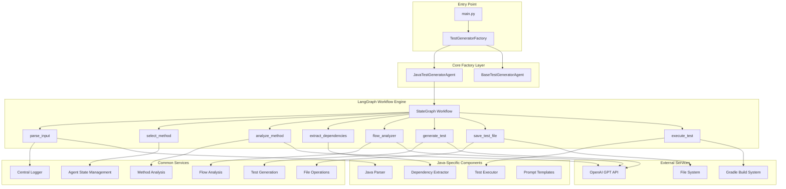
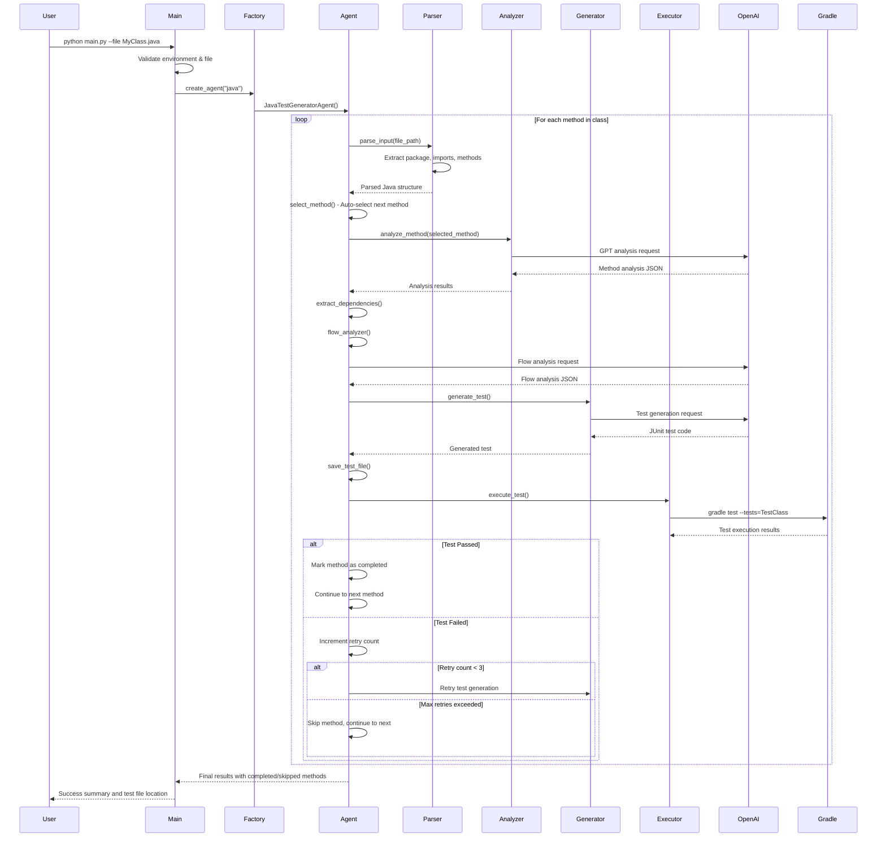

# IntelliQ Integration Test Generator - Architecture Document

## Table of Contents
1. [High-Level Architecture Overview](#high-level-architecture-overview)
2. [Detailed Flow Documentation](#detailed-flow-documentation)
3. [Domain Knowledge Documentation](#domain-knowledge-documentation)
4. [Technical Details](#technical-details)
5. [System Components](#system-components)

---

## High-Level Architecture Overview

The IntelliQ Integration Test Generator is an AI-powered system that automatically generates comprehensive integration tests for Java applications using OpenAI's GPT models and LangGraph workflow orchestration. The system follows a modular, factory-based architecture with clear separation of concerns.

### System Design Principles
- **Factory Pattern**: Language-agnostic test generation through factory-based agent creation
- **Workflow Orchestration**: LangGraph-based state management and flow control
- **AI-Driven Analysis**: GPT-powered method analysis and test generation
- **Modular Architecture**: Clear separation between common utilities and language-specific implementations
- **Fully Automated**: End-to-end automation with retry logic and error handling

### Architecture Diagram



### Main Modules and Layers

1. **Entry Layer** (`main.py`)
   - Command-line interface
   - Environment validation
   - Language detection
   - Factory orchestration

2. **Factory Layer** (`base_factory/`)
   - `BaseTestGeneratorAgent`: Abstract base class
   - `TestGeneratorFactory`: Language-specific agent creation

3. **Workflow Layer** (`java_core/`)
   - `JavaTestGeneratorAgent`: LangGraph workflow implementation
   - State management and flow control
   - Retry logic and error handling

4. **Common Services Layer** (`common/`)
   - Reusable utilities across languages
   - State management, analysis, and file operations

5. **Language-Specific Layer** (`java_core/nodes/`)
   - Java-specific parsing and execution
   - Dependency extraction and test generation

6. **Infrastructure Layer** (`central_logger/`)
   - Logging and monitoring
   - Error handling and debugging

---

## Detailed Flow Documentation

### End-to-End Processing Flow

The system processes Java source files through a comprehensive workflow that generates and executes integration tests automatically.

### Flow Diagram



### Step-by-Step Process Flow

#### 1. **Input Validation & Initialization**
- Environment variable validation (OpenAI API key, model settings)
- File existence and type validation (.java files only)
- Language detection and factory agent creation

#### 2. **Java File Parsing** (`parse_input`)
- Parse Java source code using `javalang` parser
- Extract package declaration, imports, and method signatures
- Build method metadata (name, modifiers, return type, parameters)

#### 3. **Method Selection** (`select_method`)
- **Automated Mode**: Auto-select next unprocessed public method
- **Manual Mode**: Interactive method selection (not used in current implementation)
- Track completed and skipped methods
- Reset per-method state variables

#### 4. **Method Analysis** (`analyze_method`)
- Extract method source code with JavaDoc and annotations
- Send to OpenAI GPT for intelligent analysis
- Parse JSON response containing:
  - Method summary
  - Target classification (controller/service)
  - Internal method calls
  - External dependencies with extraction flags

#### 5. **Dependency Extraction** (`extract_dependencies`)
- **Internal Dependencies**: Extract called methods from same class
- **External Dependencies**: Locate and extract methods from external classes
- Use FQN resolution with case correction and recursive search
- Normalize class names to PascalCase

#### 6. **Flow Analysis** (`flow_analyzer`)
- Analyze business flow and data flow patterns
- Generate descriptive flow name for test class naming
- Extract sequence of calls and expected outcomes
- Create flow-specific test context

#### 7. **Test Generation** (`generate_test`)
- Select appropriate prompt template (Controller vs Service)
- Build comprehensive prompt with all context
- Generate JUnit 5 integration test using OpenAI
- Handle retry scenarios with previous failure context

#### 8. **File Operations** (`save_test_file`)
- Generate test file path in `src/test/java` directory
- Ensure directory structure exists
- Save generated test class to disk
- Handle file system errors gracefully

#### 9. **Test Execution** (`execute_test`)
- Execute generated test using Gradle wrapper
- Capture stdout/stderr for debugging
- Parse execution results and error summaries
- Implement retry logic with exponential backoff

#### 10. **Completion Handling**
- Track successful method completions
- Handle retry limits and method skipping
- Continue to next method automatically
- Generate final summary report

### Error Handling and Retry Logic

The system implements comprehensive error handling at multiple levels:

1. **Parse Errors**: File not found, invalid Java syntax
2. **Analysis Errors**: OpenAI API failures, JSON parsing errors
3. **Generation Errors**: Test generation failures, invalid code
4. **Execution Errors**: Gradle failures, compilation errors, test failures

**Retry Strategy**:
- Maximum 3 retries per method
- Retry with previous failure context
- Skip method after max retries exceeded
- Continue processing remaining methods

---

## Domain Knowledge Documentation

### Business Domain: OpenCRX Integration Testing

The system is specifically designed for **OpenCRX**, an enterprise CRM system, with deep integration testing capabilities.

#### Core Business Entities

1. **Contracts** (`oocke1_contract`)
   - Primary business entity for customer agreements
   - Required fields: `object_id`, `modified_at`, `dtype`, `customer` (FK)
   - Customer relationship via `oocke1_account.object_id`

2. **Accounts** (`oocke1_account`)
   - Customer and supplier entities
   - Required fields: `object_id`, `modified_at`, `dtype`
   - Foundation for all business relationships

3. **Activities** (`oocke1_activity`)
   - Business process tracking
   - Required fields: `object_id`, `modified_at`, `dtype`, `assigned_to` (FK)
   - Assignment relationship via `oocke1_account.object_id`

4. **Products** (`oocke1_product`)
   - Product catalog management
   - Required fields: `object_id`, `modified_at`, `dtype`, `supplier` (FK)
   - Supplier relationship via `oocke1_account.object_id`

#### Business Rules and Constraints

1. **Database Schema Requirements**
   - All entities require `object_id` (VARCHAR, primary key)
   - All entities require `modified_at` (TIMESTAMPTZ)
   - All entities require `dtype` (VARCHAR, discriminator)
   - Foreign key relationships must be valid

2. **Test Generation Patterns**
   - **Service Tests**: Use raw SQL with JDO/PersistenceManager
   - **Controller Tests**: Use Spring Boot MockMvc with JSON validation
   - **Integration Focus**: Test complete business flows, not isolated units

3. **OpenCRX-Specific Patterns**
   - JDO (Java Data Objects) with DataNucleus
   - PostgreSQL database integration
   - Enterprise transaction management
   - Business workflow validation

#### Domain-Specific Terminology

- **FQN (Fully Qualified Name)**: Complete package.class name resolution
- **Dtype**: Discriminator type for JDO entity inheritance
- **PersistenceManager**: JDO interface for database operations
- **Integration Test**: End-to-end test validating complete business flows
- **Flow Analysis**: Business process analysis for test generation
- **Dependency Extraction**: Code analysis for test context building

#### Business Flow Patterns

1. **Contract Creation Flow**
   - Account creation → Contract creation → Validation
   - Customer relationship establishment
   - Business rule enforcement

2. **Activity Management Flow**
   - Activity creation → Assignment → Status tracking
   - User relationship management
   - Process workflow validation

3. **Product Catalog Flow**
   - Supplier setup → Product creation → Catalog management
   - Business relationship validation
   - Data integrity enforcement

---

## Technical Details

### Frameworks and Libraries

#### Core Dependencies
- **LangGraph** (≥0.0.55): Workflow orchestration and state management
- **OpenAI** (≥1.0.0): GPT model integration for analysis and generation
- **javalang** (≥0.13.0): Java source code parsing and AST analysis
- **typing-extensions** (≥4.0.0): Enhanced type hints support

#### External Integrations
- **OpenAI GPT API**: Method analysis, flow analysis, test generation
- **Gradle Build System**: Test execution and compilation
- **JDO/DataNucleus**: OpenCRX database persistence layer
- **JUnit 5**: Generated test framework
- **Spring Boot**: Controller testing infrastructure

### Design Patterns and Architectural Styles

#### 1. **Factory Pattern**
```python
class TestGeneratorFactory:
    @staticmethod
    def create_agent(language: str) -> BaseTestGeneratorAgent:
        if language == 'java':
            return JavaTestGeneratorAgent()
```

#### 2. **State Machine Pattern** (LangGraph)
- State-driven workflow with conditional transitions
- Immutable state updates through function composition
- Clear separation of state and behavior

#### 3. **Template Method Pattern**
- Abstract base class with common interface
- Language-specific implementations
- Consistent API across different languages

#### 4. **Strategy Pattern**
- Different prompt templates for different target types
- Configurable analysis and generation strategies
- Pluggable dependency extraction logic

#### 5. **Observer Pattern** (Logging)
- Centralized logging with multiple handlers
- Structured logging with context preservation
- Error tracking and debugging support

### Key Technical Components

#### 1. **Agent State Management**
```python
class AgentState(TypedDict, total=False):
    # Input
    file_path: str
    package: str
    imports: str
    methods: List[Dict[str, Any]]
    
    # Processing
    selected_method: str
    analysis: Dict[str, Any]
    flow_analysis: Dict[str, Any]
    
    # Output
    test_class: str
    test_file_path: str
    execution_passed: bool
```

#### 2. **Workflow Orchestration**
- **LangGraph StateGraph**: Declarative workflow definition
- **Conditional Edges**: Dynamic flow control based on state
- **Node Composition**: Modular, testable workflow components

#### 3. **AI Integration**
- **Prompt Engineering**: Structured prompts for consistent outputs
- **JSON Parsing**: Robust extraction from AI responses
- **Error Handling**: Graceful degradation on AI failures

#### 4. **Code Analysis**
- **AST Parsing**: Deep Java syntax analysis
- **Dependency Resolution**: FQN resolution with fallback strategies
- **Method Extraction**: Precise code extraction with context

#### 5. **Test Execution**
- **Gradle Integration**: Cross-platform build system support
- **Timeout Handling**: Prevent hanging test execution
- **Result Parsing**: Intelligent error extraction and summarization

### Configuration Management

#### Environment Variables
```bash
OPENAI_API_KEY=<api_key>
MODEL=gpt-4o
TEMPERATURE=0.1
MAX_TOKENS=4000
PROJECT_ROOT=/path/to/project
```

#### Prompt Templates
- **Method Analysis**: Structured JSON extraction
- **Flow Analysis**: Business process understanding
- **Test Generation**: Controller vs Service patterns
- **Error Context**: Retry with failure information

### Performance Considerations

1. **Parallel Processing**: Not implemented (sequential method processing)
2. **Caching**: No caching implemented (stateless processing)
3. **Rate Limiting**: OpenAI API rate limits handled by retry logic
4. **Memory Management**: State cleanup between method processing
5. **Timeout Handling**: 5-minute timeout for test execution

### Security Considerations

1. **API Key Management**: Environment variable storage
2. **File System Access**: Restricted to project directory
3. **Code Execution**: Sandboxed through Gradle
4. **Input Validation**: File type and existence checks
5. **Error Information**: Sanitized error messages

---

## System Components

### Core Components

#### 1. **Main Entry Point** (`main.py`)
- Command-line interface
- Environment validation
- Language detection and routing
- Error handling and user feedback

#### 2. **Factory System** (`base_factory/`)
- `BaseTestGeneratorAgent`: Abstract interface
- `TestGeneratorFactory`: Language-specific agent creation
- Extensible architecture for multiple languages

#### 3. **Java Implementation** (`java_core/`)
- `JavaTestGeneratorAgent`: LangGraph workflow implementation
- Language-specific parsing and execution
- OpenCRX-specific business logic

#### 4. **Common Services** (`common/`)
- Reusable utilities across languages
- State management and validation
- File operations and error handling

#### 5. **Infrastructure** (`central_logger/`)
- Centralized logging system
- Error tracking and debugging
- Cross-platform compatibility

### Workflow Nodes

#### 1. **Parse Input** (`java_core/nodes/parse_input.py`)
- Java source code parsing
- Package, import, and method extraction
- AST-based analysis

#### 2. **Extract Dependencies** (`java_core/nodes/extract_dependencies.py`)
- Internal method dependency extraction
- External class dependency resolution
- FQN resolution with fallback strategies

#### 3. **Execute Test** (`java_core/nodes/execute_test.py`)
- Gradle test execution
- Result parsing and error extraction
- Retry logic implementation

### Prompt Templates (`java_core/prompts.py`)

#### 1. **Method Analysis** (`CONFIG`)
- Structured JSON extraction
- Dependency identification
- Target classification

#### 2. **Flow Analysis** (`FLOW_ANALYSIS_PROMPT`)
- Business process analysis
- Flow name generation
- Sequence extraction

#### 3. **Test Generation**
- **Controller Tests** (`CONTROLLER_CONFIG`): Spring Boot MockMvc
- **Service Tests** (`SERVICE_CONFIG`): OpenCRX JDO integration

### State Management

The system uses a comprehensive state object that tracks:
- **Input State**: File path, parsed structure
- **Processing State**: Current method, analysis results
- **Output State**: Generated tests, execution results
- **Control State**: Retry counts, completion tracking

### Error Handling Strategy

1. **Validation Errors**: Input validation failures
2. **Processing Errors**: AI analysis failures
3. **Generation Errors**: Test generation failures
4. **Execution Errors**: Gradle/test execution failures
5. **System Errors**: Unexpected exceptions

Each error type has specific handling and recovery strategies, with comprehensive logging for debugging and monitoring.

---

*This architecture document provides a comprehensive overview of the IntelliQ Integration Test Generator system, covering all aspects from high-level design to implementation details and domain-specific knowledge.*
