# Nomiso IntelliQ - System Architecture Document

## Table of Contents
1. [System Overview](#system-overview)
2. [Architecture Principles](#architecture-principles)
3. [High-Level Architecture](#high-level-architecture)
4. [Component Architecture](#component-architecture)
5. [Data Flow Architecture](#data-flow-architecture)
6. [Technology Stack](#technology-stack)
7. [Deployment Architecture](#deployment-architecture)
8. [Security Architecture](#security-architecture)
9. [Performance & Scalability](#performance--scalability)
10. [Domain Knowledge Documentation](#domain-knowledge-documentation)
11. [API Documentation](#api-documentation)
12. [Configuration Management](#configuration-management)

## System Overview

Nomiso IntelliQ is an intelligent test case generation and story enhancement platform that leverages AI/ML capabilities to automate the process of creating, validating, and enhancing user stories and test cases. The system integrates multiple AI services, RAG (Retrieval-Augmented Generation) capabilities, and domain-specific knowledge to deliver high-quality, testable user stories and comprehensive test cases.

### Key Capabilities
- **Story Enhancement**: AI-powered enhancement of user stories with domain-specific context
- **Test Case Generation**: Automated generation of comprehensive test cases from enhanced stories
- **Validation & Quality Assurance**: Multi-iteration validation pipeline with accuracy measurement
- **RAG Integration**: Context-aware retrieval from knowledge bases
- **Multi-format Support**: DOCX, JIRA, and plain text parsing capabilities
- **Image Parsing**: UI structure extraction from screenshots for test case generation

## Architecture Principles

1. **Modular Design**: Loosely coupled, highly cohesive components
2. **Service-Oriented Architecture**: Clear separation of concerns with dedicated services
3. **AI-First Approach**: LLM integration at multiple layers for intelligent processing
4. **Extensibility**: Plugin-based architecture for new parsers and output formats
5. **Fault Tolerance**: Retry mechanisms and graceful degradation
6. **Observability**: Comprehensive logging and monitoring throughout the system

## High-Level Architecture

```
┌─────────────────────────────────────────────────────────────────────────────┐
│                           Nomiso IntelliQ Platform                         │
├─────────────────────────────────────────────────────────────────────────────┤
│                                                                             │
│  ┌─────────────────┐    ┌─────────────────┐    ┌─────────────────────────┐ │
│  │   Input Layer   │    │  Processing     │    │     Output Layer        │ │
│  │                 │    │    Pipeline     │    │                         │ │
│  │ • DOCX Parser  │───▶│ • Story         │───▶│ • Enhanced Stories     │ │
│  │ • JIRA Parser  │    │   Processor     │    │ • Test Cases           │ │
│  │ • Image Parser │    │ • Workflow      │    │ • Validation Reports   │ │
│  │ • Plain Text   │    │   Manager       │    │ • DOCX Output         │ │
│  └─────────────────┘    │ • RAG Service   │    │ • JIRA Integration    │ │
│                          └─────────────────┘    └─────────────────────────┘ │
│                                   │                                          │
│                          ┌─────────────────┐                                │
│                          │   AI Services   │                                │
│                          │                 │                                │
│                          │ • LLM Client    │                                │
│                          │ • Enhancer      │                                │
│                          │ • Validator     │                                │
│                          │ • Test Generator│                                │
│                          └─────────────────┘                                │
│                                   │                                          │
│                          ┌─────────────────┐                                │
│                          │  Knowledge      │                                │
│                          │   Base          │                                │
│                          │                 │                                │
│                          │ • RAG Pipeline  │                                │
│                          │ • Domain        │                                │
│                          │   Context       │                                │
│                          │ • Templates     │                                │
│                          └─────────────────┘                                │
└─────────────────────────────────────────────────────────────────────────────┘
```

### System Architecture Diagram

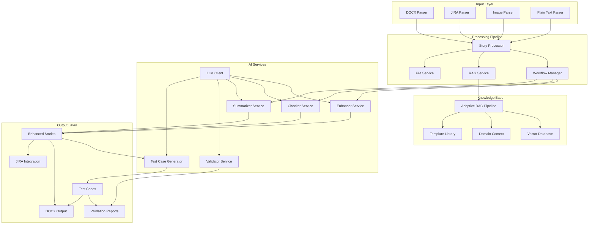

## Component Architecture

### Core Components

#### 1. Story Processor (`components/common/story_processor.py`)
- **Purpose**: Central orchestrator for the entire story processing pipeline
- **Responsibilities**:
  - Coordinate all services and workflows
  - Manage document processing lifecycle
  - Handle parallel processing and error recovery
  - Integrate test case generation and validation

#### 2. Workflow Manager (`components/common/workflow_manager.py`)
- **Purpose**: Manages the state-based workflow using LangGraph
- **Responsibilities**:
  - Build and execute workflow graphs
  - Manage state transitions between workflow steps
  - Handle retry logic and error recovery
  - Coordinate RAG, checker, and enhancer services

#### 3. LLM Client (`components/common/llm_client.py`)
- **Purpose**: Centralized interface for OpenAI API interactions
- **Responsibilities**:
  - Handle authentication and API calls
  - Manage model selection and configuration
  - Provide consistent response formatting
  - Handle rate limiting and error recovery

#### 4. RAG Service (`components/common/rag_service.py`)
- **Purpose**: Retrieval-Augmented Generation for context-aware processing
- **Responsibilities**:
  - Extract text from source documents
  - Query knowledge base for relevant context
  - Integrate with AdaptiveRAG pipeline
  - Provide domain-specific context for enhancement

### Enhancement Components

#### 1. Enhancer Service (`components/story_enhancer/enhancer_service.py`)
- **Purpose**: AI-powered story enhancement based on feedback
- **Responsibilities**:
  - Process checker feedback
  - Generate enhanced story content
  - Apply domain-specific improvements
  - Maintain story structure and consistency

#### 2. Checker Service (`components/story_enhancer/checker_service.py`)
- **Purpose**: Quality assessment and feedback generation
- **Responsibilities**:
  - Evaluate story quality and completeness
  - Provide structured feedback for each field
  - Assess domain-specific requirements
  - Generate improvement recommendations

#### 3. Summarizer Service (`components/story_enhancer/summarizer_service.py`)
- **Purpose**: Generate concise summaries of enhanced stories
- **Responsibilities**:
  - Create executive summaries
  - Highlight key changes and improvements
  - Maintain traceability to original content

### Test Case Generation Components

#### 1. Test Case Pipeline (`components/test_case_generator/pipeline.py`)
- **Purpose**: Orchestrate test case generation workflow
- **Responsibilities**:
  - Load and parse input documents
  - Coordinate parallel test case generation
  - Manage business context integration
  - Handle duplicate detection and resolution

#### 2. Test Case Generator (`components/test_case_generator/test_case_generator.py`)
- **Purpose**: Core logic for test case creation
- **Responsibilities**:
  - Generate test scenarios from user stories
  - Apply testing best practices
  - Ensure coverage of acceptance criteria
  - Generate platform-specific test cases

### Validation Components

#### 1. Validator Service (`components/story_validator/validator_service.py`)
- **Purpose**: Validate generated test cases against stories
- **Responsibilities**:
  - Assess test case quality and relevance
  - Validate coverage of story requirements
  - Generate validation reports
  - Identify gaps and inconsistencies

#### 2. Accuracy Measure Service (`components/story_validator/accuracy_measure_service.py`)
- **Purpose**: Measure and report test case accuracy
- **Responsibilities**:
  - Calculate accuracy metrics
  - Generate performance reports
  - Track improvement over iterations
  - Provide actionable insights

#### 3. Failed Test Cases Regeneration Service (`components/story_validator/failed_testcases_regeneration_service.py`)
- **Purpose**: Regenerate failed test cases with improvements
- **Responsibilities**:
  - Analyze validation failures
  - Generate improved test cases
  - Maintain consistency with original requirements
  - Track regeneration success rates

### Parser Components

#### 1. DOCX Parser (`components/parser/parser.py`)
- **Purpose**: Extract content from Microsoft Word documents
- **Responsibilities**:
  - Parse DOCX file structure
  - Extract text and formatting
  - Handle complex document layouts
  - Preserve document hierarchy

#### 2. JIRA Parser (`components/parser/jira_parser.py`)
- **Purpose**: Extract user stories from JIRA
- **Responsibilities**:
  - Connect to JIRA API
  - Extract story metadata and content
  - Handle JIRA-specific formatting
  - Support bulk story processing

#### 3. Image Parser (`components/image_parser/`)
- **Purpose**: Extract UI structure from screenshots
- **Responsibilities**:
  - Analyze image layouts
  - Detect UI components
  - Generate structured representations
  - Support test case generation for UI flows

### Adaptive RAG Components

#### 1. Adaptive RAG Pipeline (`components/adaptive_rag/main.py`)
- **Purpose**: Intelligent document retrieval and context generation
- **Responsibilities**:
  - Query vector database
  - Retrieve relevant document chunks
  - Adapt retrieval based on user type
  - Provide context for story enhancement

#### 2. Retriever Node (`components/adaptive_rag/retriever.py`)
- **Purpose**: Core retrieval logic for RAG operations
- **Responsibilities**:
  - Execute vector similarity search
  - Filter results by relevance
  - Handle metadata-based filtering
  - Optimize retrieval parameters

### Component Interaction Diagram

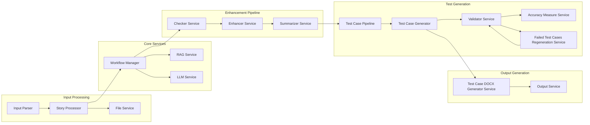

## Data Flow Architecture

### Primary Story Processing Flow

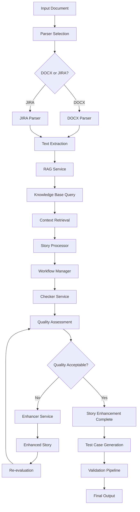

### Test Case Generation Flow

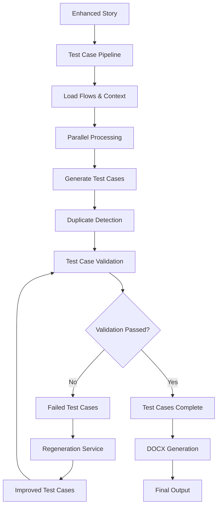

### RAG Context Retrieval Flow

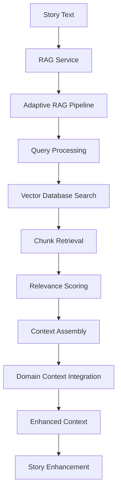

### Detailed Workflow State Machine

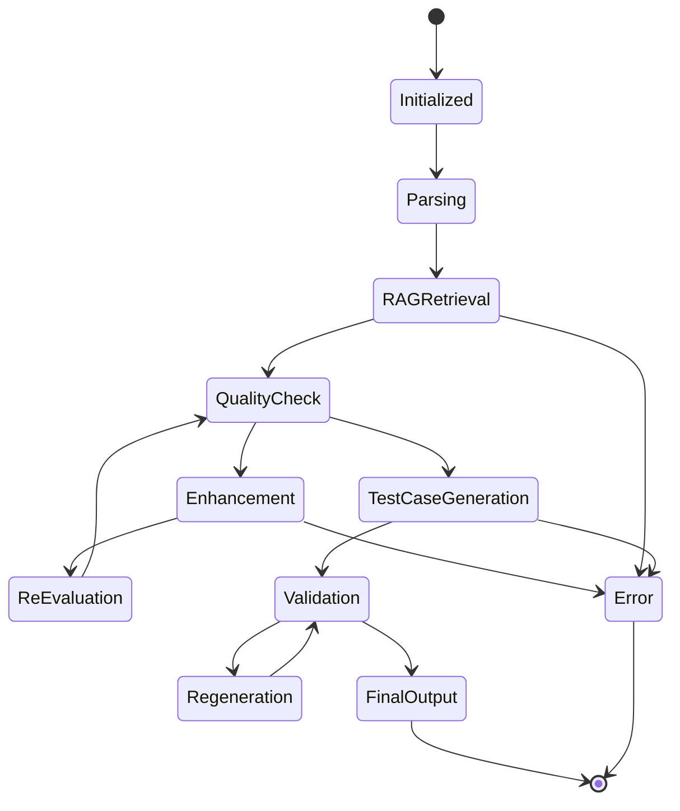

### Service Dependency Graph

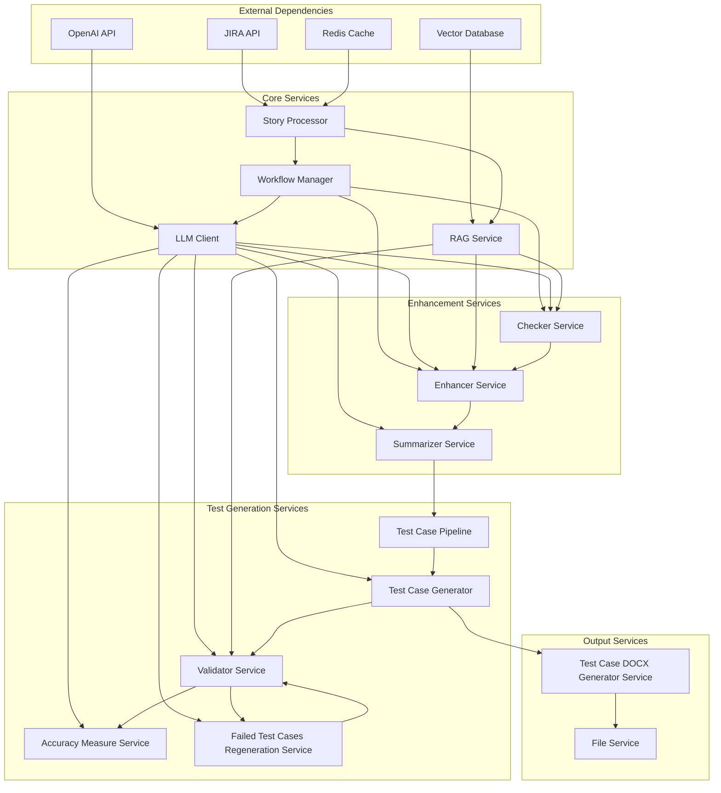

## Technology Stack

### Backend Technologies
- **Python 3.8+**: Core application language
- **Flask**: Web framework for API endpoints
- **LangGraph**: Workflow orchestration and state management
- **OpenAI API**: LLM integration for AI-powered processing
- **PostgreSQL + pgvector**: Vector database for RAG operations
- **Redis**: Caching and session management

### AI/ML Technologies
- **OpenAI GPT Models**: Text generation and analysis
- **Vector Embeddings**: Semantic search and retrieval
- **RAG Pipeline**: Context-aware generation
- **Prompt Engineering**: Structured AI interactions

### Data Processing
- **python-docx**: DOCX document parsing
- **JIRA API**: Issue tracking integration
- **Pillow/OpenCV**: Image processing and analysis
- **JSON**: Data serialization and storage

### Infrastructure
- **Docker**: Containerization
- **WSL2**: Windows Subsystem for Linux compatibility
- **File System**: Local storage for documents and outputs
- **Logging**: Centralized logging with rotation

### Technology Stack Diagram

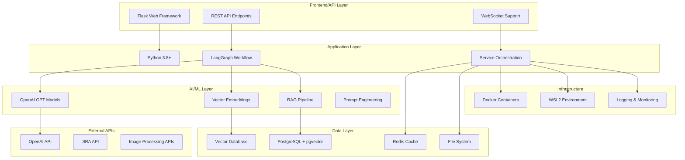

## Deployment Architecture

### Development Environment
```
┌─────────────────────────────────────────────────────────────────────────────┐
│                           Development Environment                           │
├─────────────────────────────────────────────────────────────────────────────┤
│                                                                             │
│  ┌─────────────────┐    ┌─────────────────┐    ┌─────────────────────────┐ │
│  │   Local IDE     │    │   WSL2 Ubuntu   │    │    File System          │ │
│  │                 │    │                 │    │                         │
│  │ • VS Code       │◄──▶│ • Python 3.8+  │◄──▶│ • Input Documents      │ │
│  │ • Python        │    │ • Dependencies  │    │ • Output Files         │ │
│  │ • Git           │    │ • Services      │    │ • Logs                 │ │
│  └─────────────────┘    └─────────────────┘    └─────────────────────────┘ │
│                                   │                                          │
│                          ┌─────────────────┐                                │
│                          │   External      │                                │ │
│                          │   Services      │                                │ │
│                          │                 │                                │ │
│                          │ • OpenAI API    │                                │ │
│                          │ • JIRA API      │                                │ │
│                          │ • Vector DB     │                                │ │
│                          └─────────────────┘                                │ │
└─────────────────────────────────────────────────────────────────────────────┘
```

### Production Deployment
```
┌─────────────────────────────────────────────────────────────────────────────┐
│                           Production Environment                           │
├─────────────────────────────────────────────────────────────────────────────┤
│                                                                             │
│  ┌─────────────────┐    ┌─────────────────┐    ┌─────────────────────────┐ │
│  │   Load          │    │   Application   │    │    Data Layer           │ │
│  │   Balancer      │    │   Servers       │    │                         │ │
│  │                 │    │                 │    │                         │ │
│  │ • Nginx         │───▶│ • Docker        │───▶│ • PostgreSQL           │ │
│  │ • SSL/TLS       │    │   Containers    │    │ • Redis                │ │
│  │ • Health Checks │    │ • Auto-scaling  │    │ • File Storage         │ │
│  └─────────────────┘    └─────────────────┘    └─────────────────────────┘ │
│                                   │                                          │
│                          ┌─────────────────┐                                │
│                          │   Monitoring    │                                │ │
│                          │   & Logging     │                                │ │
│                          │                 │                                │ │
│                          │ • Prometheus    │                                │ │
│                          │ • Grafana       │                                │ │
│                          │ • ELK Stack     │                                │ │
│                          └─────────────────┘                                │ │
└─────────────────────────────────────────────────────────────────────────────┘
```

### Deployment Architecture Diagram

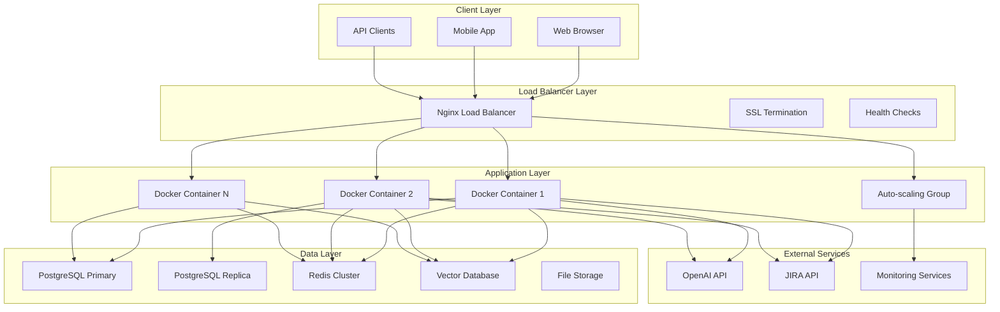

## Security Architecture

### Authentication & Authorization
- **API Key Management**: Secure storage of OpenAI and JIRA API keys
- **Environment Variables**: Sensitive configuration via .env files
- **Access Control**: Role-based access for different user types
- **Session Management**: Secure session handling with Redis

### Data Security
- **Input Validation**: Comprehensive input sanitization
- **Output Sanitization**: Safe handling of generated content
- **File Upload Security**: Validation of document formats and content
- **Data Encryption**: Encryption at rest and in transit

### API Security
- **Rate Limiting**: Protection against API abuse
- **CORS Configuration**: Controlled cross-origin access
- **Input Validation**: Schema validation for all inputs
- **Error Handling**: Secure error messages without information leakage

### Security Architecture Diagram

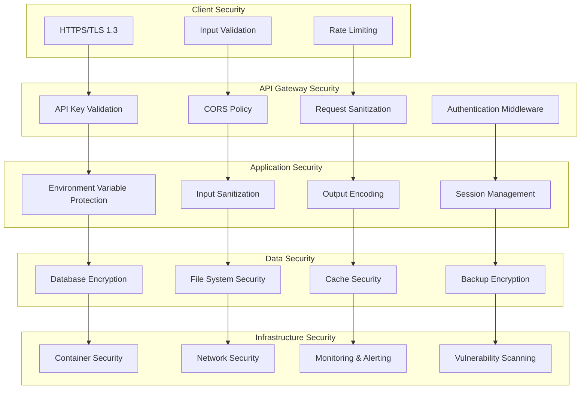

## Performance & Scalability

### Performance Optimizations
- **Parallel Processing**: Multi-threaded test case generation
- **Caching Strategy**: Redis-based caching for RAG results
- **Batch Processing**: Efficient handling of multiple documents
- **Async Operations**: Non-blocking I/O operations

### Scalability Features
- **Horizontal Scaling**: Docker container orchestration
- **Load Balancing**: Distribution of processing load
- **Database Optimization**: Vector indexing for fast retrieval
- **Resource Management**: Efficient memory and CPU utilization

### Monitoring & Metrics
- **Performance Metrics**: Response times and throughput
- **Resource Utilization**: CPU, memory, and disk usage
- **Error Rates**: Failure tracking and alerting
- **Business Metrics**: Processing success rates and quality scores

### Performance Architecture Diagram

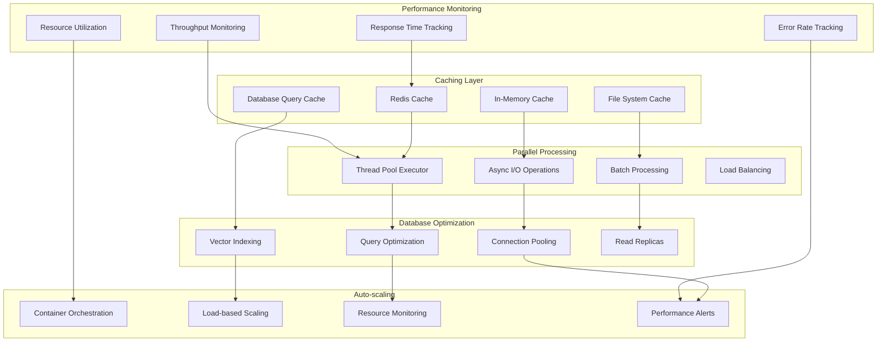

## Domain Knowledge Documentation

### Knowledge Base Structure

The system maintains a comprehensive knowledge base that serves as the foundation for domain-specific story enhancement and test case generation.

#### 1. Vector Database (`knowledgebase/`)
- **Purpose**: Store document chunks with vector embeddings for semantic search
- **Content**: Domain-specific documents, templates, and best practices
- **Technology**: PostgreSQL with pgvector extension
- **Access**: Via AdaptiveRAG pipeline for context retrieval

#### 2. Domain Context Integration
- **Business Rules**: Domain-specific business logic and constraints
- **System Integration**: API specifications and system dependencies
- **Compliance Requirements**: Regulatory and industry standards
- **Testing Standards**: Quality assurance and testing methodologies

#### 3. Template Library
- **Story Templates**: Pre-defined structures for different story types
- **Test Case Templates**: Standardized test case formats
- **Validation Templates**: Quality assessment frameworks
- **Output Templates**: Standardized output formats (DOCX, JIRA, JSON)

### Knowledge Base Components

#### 1. Adaptive RAG Pipeline
- **Retriever Node**: Core retrieval logic with vector similarity search
- **Context Assembly**: Intelligent combination of retrieved chunks
- **Domain Filtering**: Relevance-based filtering for domain context
- **Dynamic Adaptation**: Query-specific retrieval optimization

#### 2. Domain-Specific Prompts
- **Enhanced Prompts**: Domain-aware prompt engineering
- **Context Integration**: RAG context integration in prompts
- **Quality Standards**: Domain-specific quality criteria
- **Validation Rules**: Domain-relevant validation logic

#### 3. Business Context Management
- **Actor Definitions**: User roles and permissions
- **System Dependencies**: Integration points and dependencies
- **Business Rules**: Domain-specific business logic
- **Compliance Requirements**: Regulatory and industry standards

### Knowledge Base Integration

The knowledge base integrates with the main system through:

1. **RAG Service**: Primary interface for context retrieval
2. **Prompt Engineering**: Domain-specific prompt generation
3. **Validation Logic**: Quality assessment based on domain knowledge
4. **Test Case Generation**: Domain-aware test scenario creation

### Knowledge Base Architecture Diagram

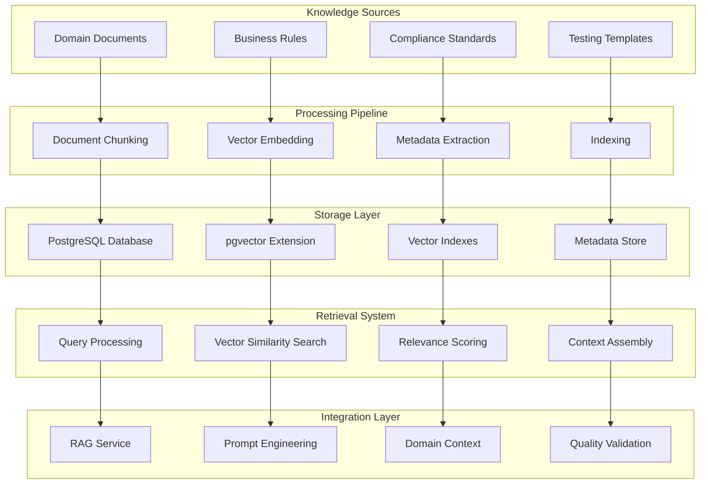

## API Documentation

### Core API Endpoints

#### 1. Story Processing API
- **POST /process-story**: Process a single story document
- **POST /process-batch**: Process multiple stories in batch
- **GET /status/{job_id}**: Get processing status

#### 2. Test Case Generation API
- **POST /generate-testcases**: Generate test cases from enhanced story
- **POST /validate-testcases**: Validate generated test cases
- **POST /regenerate-failed**: Regenerate failed test cases

#### 3. JIRA Integration API
- **POST /jira/import**: Import stories from JIRA
- **POST /jira/export**: Export enhanced stories to JIRA
- **GET /jira/status**: Get JIRA integration status

### API Response Formats

#### Standard Response Structure
```json
{
  "status": "success|error|processing",
  "message": "Human readable message",
  "data": {
    "job_id": "unique_identifier",
    "result": "processing_result",
    "metadata": "additional_information"
  },
  "timestamp": "ISO_8601_timestamp"
}
```

#### Error Response Structure
```json
{
  "status": "error",
  "error": {
    "code": "ERROR_CODE",
    "message": "Error description",
    "details": "Additional error information"
  },
  "timestamp": "ISO_8601_timestamp"
}
```

### API Architecture Diagram

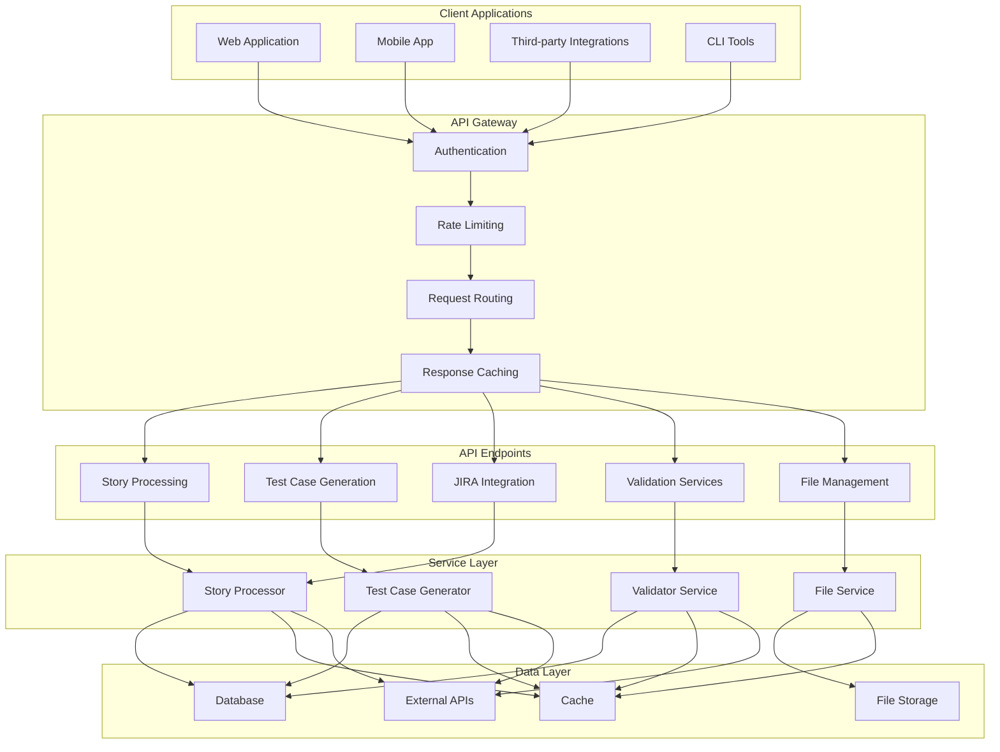

## Configuration Management

### Environment Configuration

The system uses a hierarchical configuration approach:

#### 1. Environment Variables (.env)
- **API Keys**: OpenAI, JIRA, and other external service credentials
- **Database Configuration**: Connection strings and credentials
- **Feature Flags**: Enable/disable specific functionality
- **Performance Tuning**: Parallel processing and caching parameters

#### 2. Application Settings (`components/common/settings.py`)
- **Default Values**: Fallback configuration values
- **Validation Logic**: Configuration validation and error handling
- **Dynamic Configuration**: Runtime configuration updates
- **Environment-Specific Settings**: Development vs. production configurations

#### 3. Component-Specific Configuration
- **Service Configuration**: Individual service settings
- **Parser Configuration**: Document parser specific settings
- **Output Configuration**: Format and structure preferences
- **Validation Configuration**: Quality assessment parameters

### Configuration Categories

#### 1. Core System Configuration
- **Model Selection**: LLM model selection and parameters
- **Processing Limits**: Maximum attempts and retry configurations
- **Output Directories**: File storage and organization
- **Logging Configuration**: Log levels and file management

#### 2. Feature Configuration
- **Service Enablement**: Enable/disable specific services
- **Output Formats**: Supported output format selection
- **Integration Settings**: External service configurations
- **Quality Thresholds**: Validation and quality criteria

#### 3. Performance Configuration
- **Parallel Processing**: Worker thread configuration
- **Caching Settings**: Cache TTL and storage configuration
- **Batch Processing**: Batch size and processing limits
- **Resource Limits**: Memory and CPU utilization limits

### Configuration Validation

The system includes comprehensive configuration validation:

1. **Required Parameters**: Validation of mandatory configuration
2. **Type Validation**: Data type and format validation
3. **Range Validation**: Numeric parameter range checking
4. **Dependency Validation**: Inter-parameter dependency validation
5. **Environment Validation**: Runtime environment compatibility checking

### Configuration Management Diagram

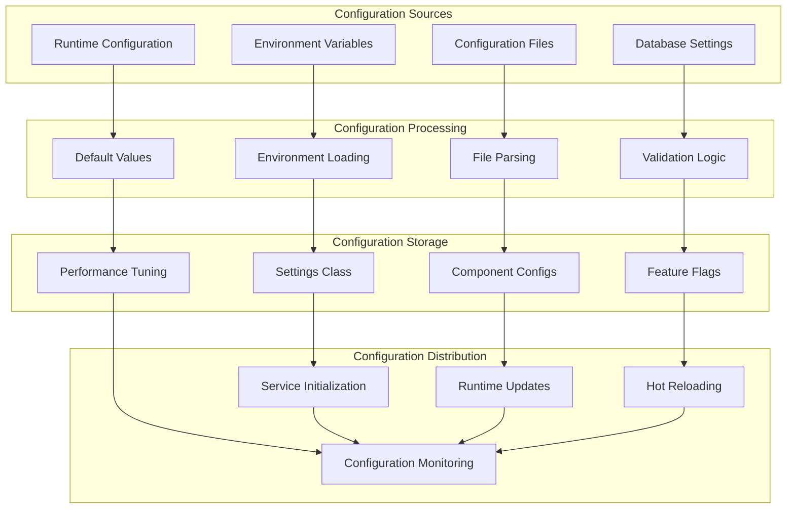

---

## Conclusion

This architecture document provides a comprehensive overview of the Nomiso IntelliQ platform, detailing its component structure, data flows, technology stack, and deployment considerations. The system is designed with modularity, scalability, and extensibility in mind, leveraging AI/ML capabilities to deliver intelligent story enhancement and test case generation.

The architecture supports both development and production environments, with robust error handling, comprehensive logging, and performance optimization features. The knowledge base integration ensures domain-specific quality and relevance, while the modular design allows for easy extension and customization.

For implementation details, refer to the individual component documentation and code comments throughout the codebase.
