# Nomiso IntelliQ - Architecture Diagrams

This document contains comprehensive Mermaid diagrams that visualize the system architecture, data flows, and component interactions of the Nomiso IntelliQ platform.

## 1. System Architecture Overview

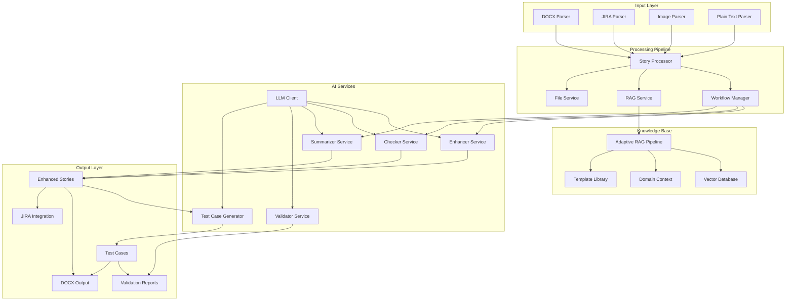

## 2. Component Interaction Diagram

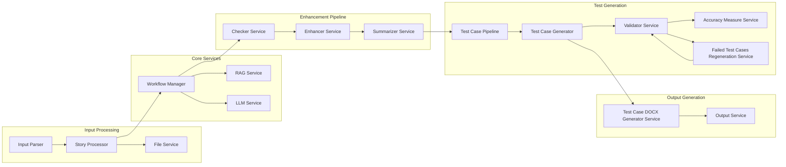

## 3. Primary Story Processing Flow

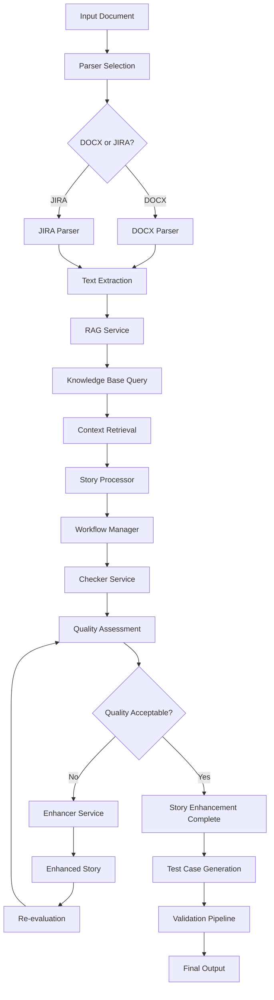

## 4. Test Case Generation Flow

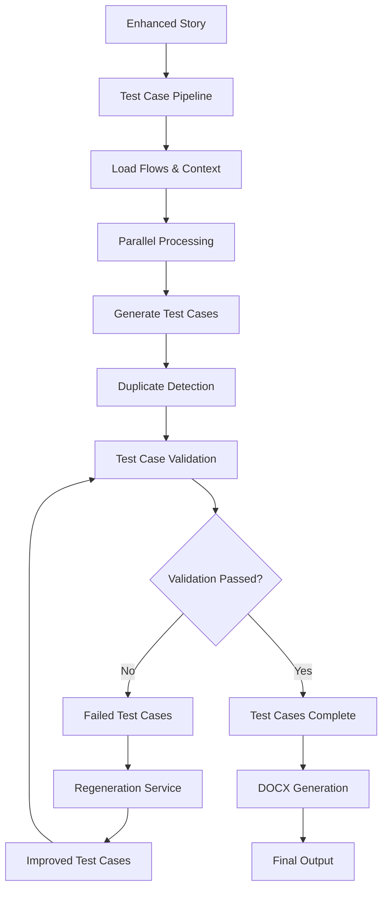

## 5. RAG Context Retrieval Flow

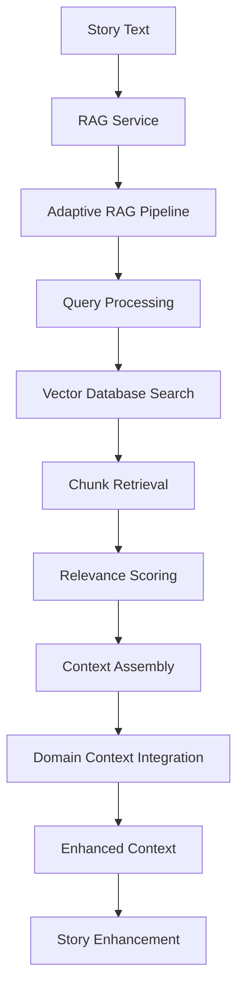

## 6. Detailed Workflow State Machine

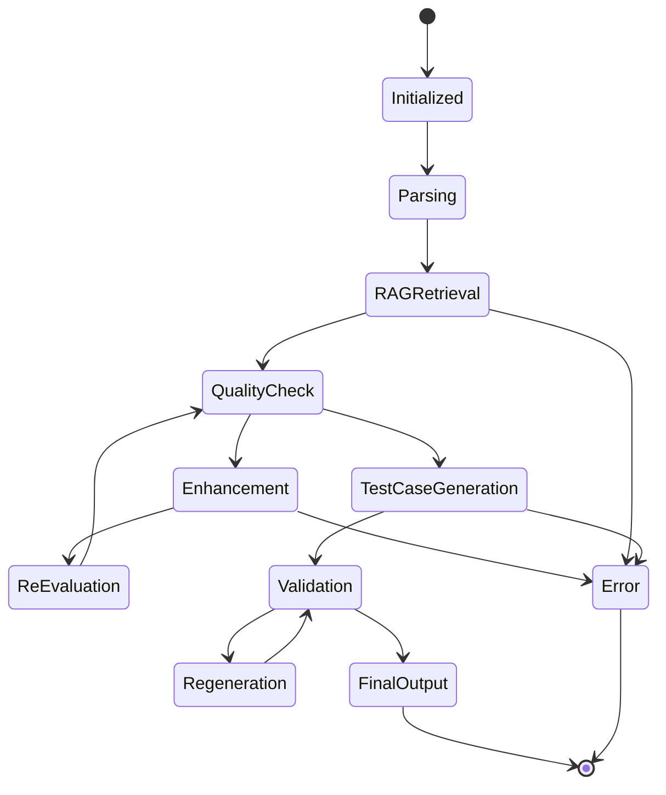

## 7. Service Dependency Graph

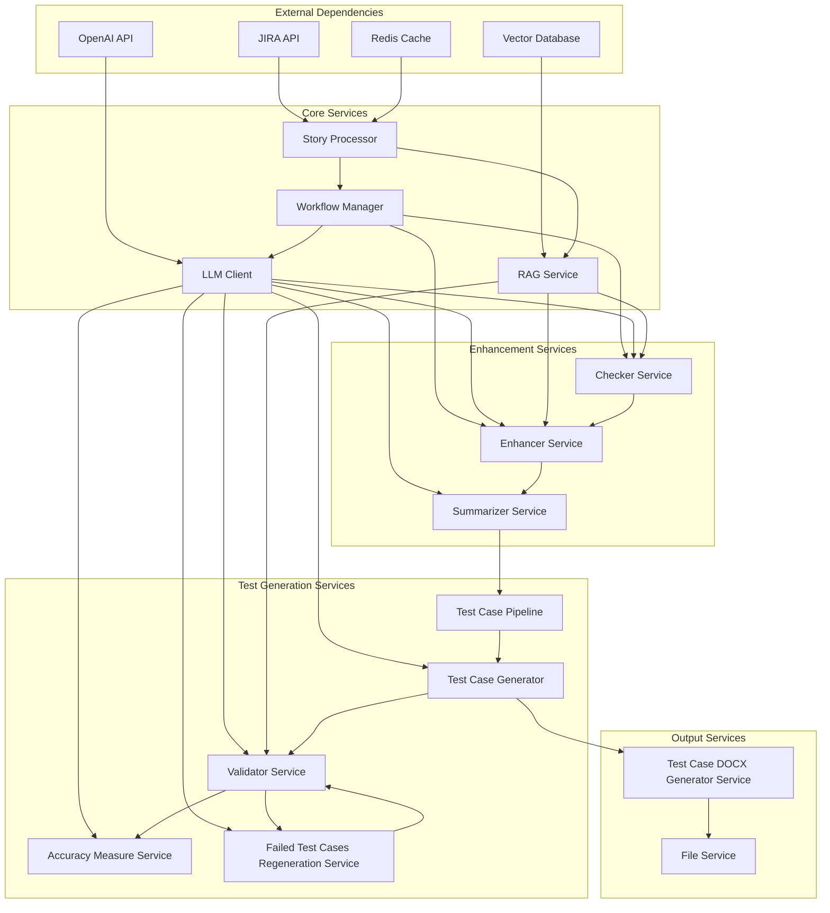

## 8. Technology Stack Diagram

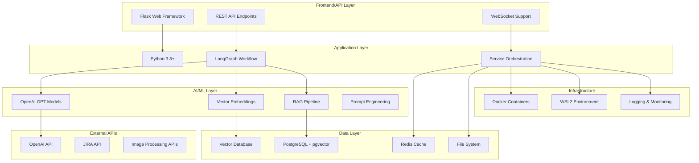

## 9. Deployment Architecture Diagram

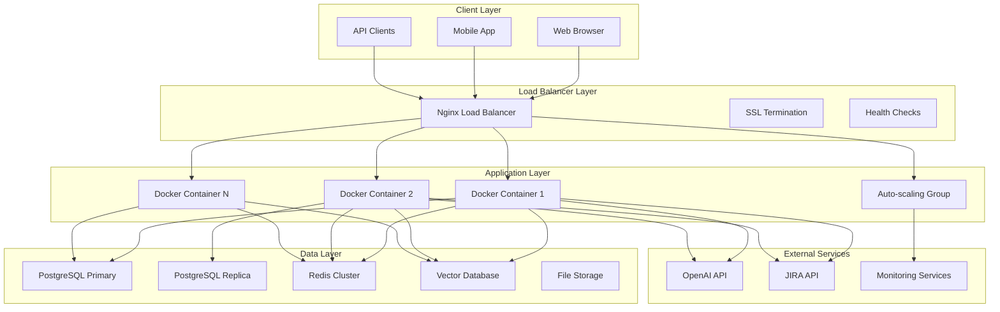

## 10. Security Architecture Diagram

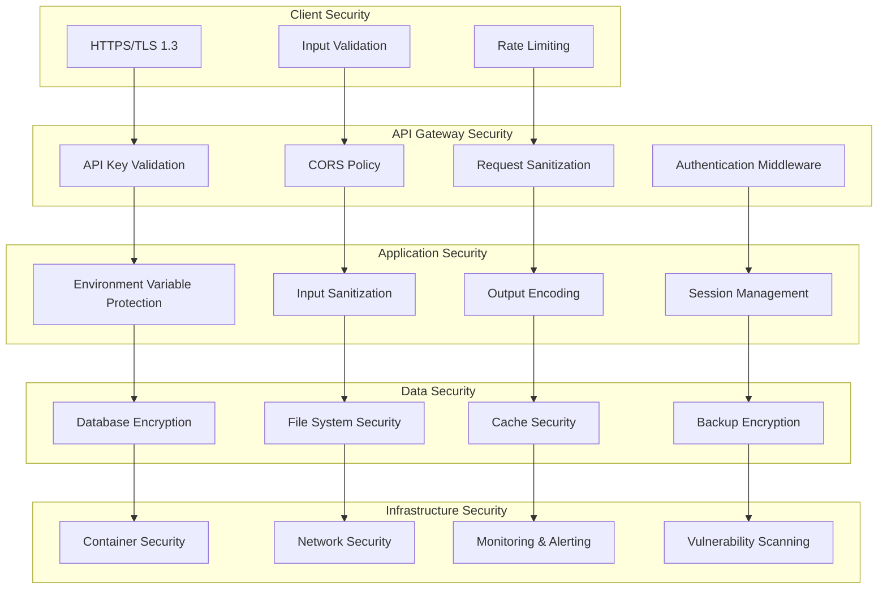

## 11. Performance Architecture Diagram

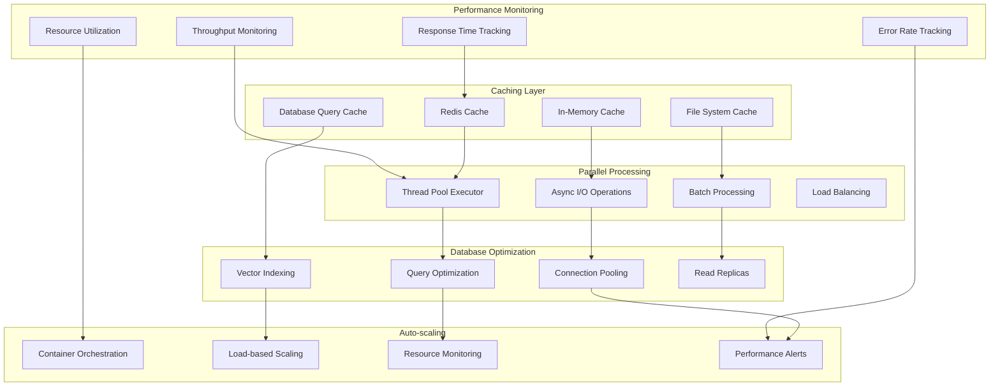

## 12. Knowledge Base Architecture Diagram

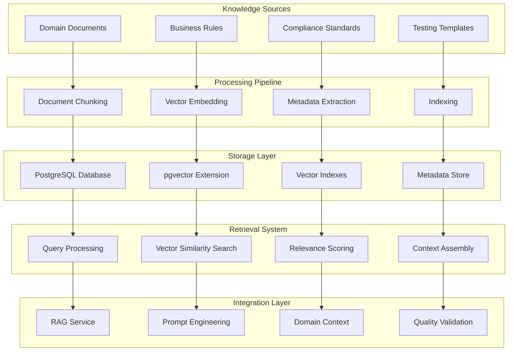

## 13. API Architecture Diagram

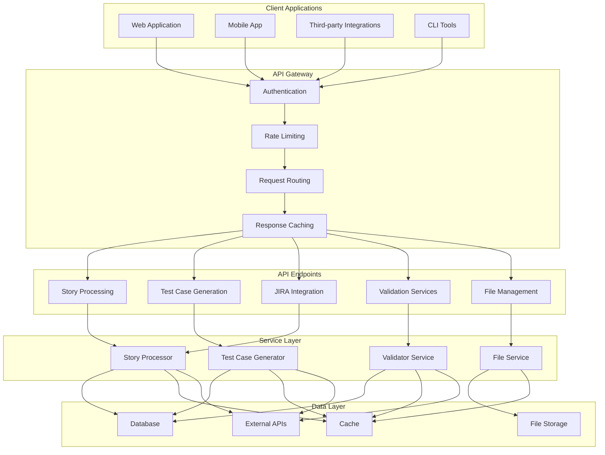

## 14. Configuration Management Diagram

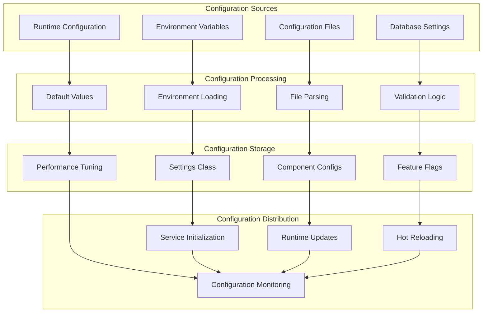

## 15. Complete System Integration Diagram

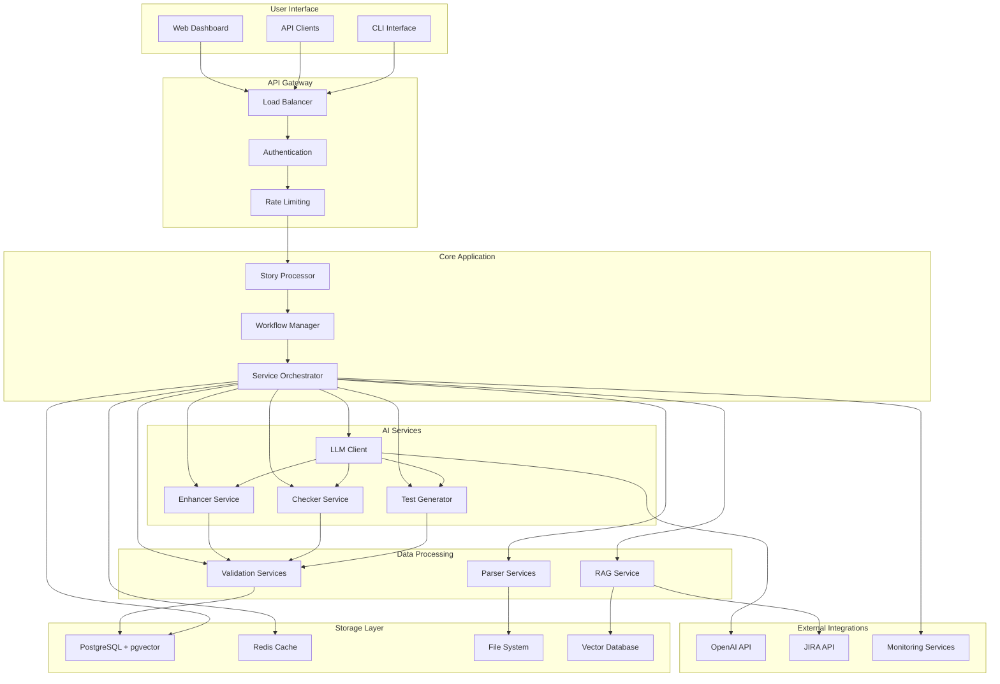

---

## Diagram Usage Instructions

These Mermaid diagrams can be rendered in:

1. **GitHub**: GitHub supports Mermaid diagrams natively in markdown files
2. **GitLab**: GitLab also supports Mermaid diagrams
3. **VS Code**: Use the Mermaid Preview extension
4. **Online Mermaid Editor**: https://mermaid.live/
5. **Documentation Tools**: Many documentation platforms support Mermaid

## Key Architecture Patterns

1. **Layered Architecture**: Clear separation between input, processing, and output layers
2. **Service-Oriented Design**: Modular services with well-defined responsibilities
3. **Event-Driven Workflow**: State-based workflow management using LangGraph
4. **AI-First Integration**: LLM services integrated at multiple layers
5. **RAG-Powered Context**: Retrieval-augmented generation for domain knowledge
6. **Microservices Pattern**: Independent services that can be scaled and deployed separately

## Component Relationships

- **Story Processor**: Central orchestrator coordinating all services
- **Workflow Manager**: Manages state transitions and retry logic
- **RAG Service**: Provides context-aware information retrieval
- **AI Services**: Handle intelligent processing and generation
- **Validation Pipeline**: Ensures quality and accuracy of outputs
- **Knowledge Base**: Stores domain-specific context and templates
